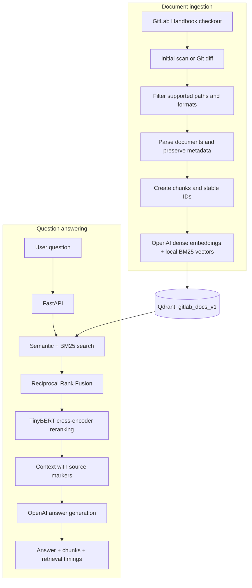

# 🦊 GitLab Knowledge Assistant

### Hybrid RAG over the GitLab Handbook


Ask questions about GitLab policies, processes, and internal documentation through a retrieval-augmented generation (RAG) API. The assistant combines semantic search, BM25 keyword search, and cross-encoder reranking to supply relevant handbook content to an OpenAI model, then returns an answer with source markers and retrieval diagnostics.

[Overview](#overview) · [Architecture](#-system-architecture) · [Design decisions](#design-decisions-and-project-evolution) · [Evaluation](#evaluation-and-what-i-learned) · [Setup](#-installation--setup) · [Deployment](#deployment-status) · [API](#-api-usage)

---

## Overview

The GitLab Handbook contains documentation spread across Markdown pages, YAML files, PDFs, and spreadsheets. This project turns selected parts of that repository into a searchable knowledge base and exposes question answering through FastAPI.

The retrieval pipeline searches for both meaning and exact terms, merges the results using Reciprocal Rank Fusion (RRF), and reranks the candidates before generating an answer. Responses include the retrieved chunks and their metadata so the supporting material can be inspected.

Example questions:

- What is GitLab's parental leave policy, and who is eligible?
- How does GitLab run asynchronous meetings?
- What are the steps in the employee onboarding process?

> **Project status:** A working local RAG API with incremental ingestion and tracing. Qdrant runs in Docker; API containerization and public-service hardening are still planned.

## ✨ Key Features

### 🔍 Hybrid retrieval and answer generation

- **Semantic search:** OpenAI `text-embedding-3-small` embeddings with cosine similarity in Qdrant.
- **Keyword search:** Local `Qdrant/bm25` sparse embeddings with Qdrant's IDF modifier.
- **Rank fusion:** RRF combines semantic and keyword results while retaining each method's scores and ranks.
- **Cross-encoder reranking:** `Xenova/ms-marco-TinyBERT-L-2-v2` scores the fused candidates against the question.
- **Answers with source markers:** The generation prompt includes retrieved content and metadata and requests citations such as `[S1]` and `[S2]`.

### 📚 Document ingestion and synchronization

- **Multiple formats:** Markdown, YAML, PDF, and Excel ingestion with format-specific processing.
- **Source metadata:** Preserves Markdown frontmatter, PDF page numbers, and spreadsheet sheet names and row ranges.
- **Incremental updates:** Uses Git diffs to identify additions, modifications, and deletions.
- **Resumable runs:** Persists pending work and checkpoints to resume an interrupted ingestion.
- **Verified writes:** Checks source-level chunk counts before acknowledging successful additions or deletions.
- **Stable chunk IDs:** Derives UUIDs from the source, content, location, and repeated-chunk occurrence.
- **Webhook integration:** Accepted GitLab push events schedule synchronization as a background task.

### 📊 Observability

- Langfuse traces for retrieval, reranking, generation, Git synchronization, and ingestion.
- Separate timings for semantic search, BM25, fusion, reranking, and total retrieval.
- Answer request IDs and structured logs containing timings and returned chunk IDs.
- JSON ingestion reports with commit references, file outcomes, chunk counts, and embedding input-token usage.

## 🏗️ System Architecture



### Retrieval flow

With the default settings, each question follows this sequence:

1. Embed the query and retrieve up to **16 semantic matches** from Qdrant.
2. Generate a local BM25 query vector and retrieve up to **16 keyword matches**.
3. Fuse both ranked lists using RRF and retain up to **8 candidates**.
4. Rerank the candidates with the cross-encoder and select up to **5 chunks**.
5. Pass the question, selected chunks, and metadata to the answer model.
6. Return the generated text, supporting chunks, and retrieval timings.

### Ingestion flow and recovery

The index has a different lifecycle from an API request. It is built once, then updated as the handbook changes:

```text
Initial indexing                         Incremental indexing
Tracked files at current commit          Diff indexed commit → origin/main
              \                           /
               Persist pending file lists
                          |
              Filter additions by path and type
                          |
              Delete removed / modified sources
                          |
              Parse and chunk accepted additions
                          |
              Clear partial writes for those sources
                          |
              Embed and upsert in batches of 100
                          |
              Verify per-source chunk counts
                          |
              Acknowledge files → save checkpoint
```

A modified file appears in both the deletion and addition lists. Deletions are not passed through an existence filter: a deleted file no longer exists on disk, but its old chunks still need removing from Qdrant.

The Git checkout and the indexing checkpoint are separate. Moving the checkout to a new commit does not mean its content has reached the database. The checkpoint advances only after all pending items are acknowledged, including files deliberately skipped by filtering or PDF conversion policy.

### What a Qdrant point contains

Each chunk is stored as one point with a deterministic UUID, two named vectors, and a payload:

```text
point
├── id: UUID derived from source + content + location + occurrence
├── vector
│   ├── dense: 1,536 floating-point values
│   └── bm25: sparse indices and weights
└── payload
    ├── page_content: chunk text
    └── metadata: source, frontmatter, page/sheet/row information
```

Dense and sparse retrieval return the same point IDs, which makes merging their results straightforward. Nested metadata stays in the payload; it is not itself a vector. Embeddings are generated from `page_content`, while the answer prompt receives both text and metadata.

## Design Decisions and Project Evolution

This project grew from a Markdown ingestion script into a hybrid retrieval API. Each change addressed a concrete limitation encountered while building and testing it.

### From Chroma to Qdrant

I started with Chroma for storing dense embeddings. When I added BM25, I wanted dense and sparse representations attached to the same chunk rather than maintaining a separate keyword index and manually coordinating identifiers.

Qdrant's named vectors let each point hold both representations, with an IDF modifier configured for the BM25 vector. The existing dense embeddings were transferred rather than regenerated just to change databases. The project then moved from local Qdrant storage to a Docker-hosted Qdrant server, separating database storage from the Python process.

Qdrant also supports nested payloads, so I removed the metadata-flattening step introduced for the earlier storage design. Values are still normalized through JSON serialization, with unsupported objects such as dates converted to strings.

### Why semantic search, BM25, and RRF?

Handbook questions can describe an idea without using the document's wording, but they can also contain exact acronyms, policy names, and technical commands. Semantic search and lexical retrieval provide complementary candidate lists.

I implemented fusion explicitly to understand and inspect how the two methods interact. Their raw scores have different meanings, so RRF combines **positions** instead:

```text
RRF(chunk) = sum(1 / (60 + rank_in_result_list))
```

Ranks start at one. A chunk found by both retrievers receives contributions from both lists. The response retains the original scores and ranks alongside the fused score, allowing retrieval decisions to be inspected later. These scores are ranking signals, not calibrated confidence probabilities.

### Why a cross-encoder after fusion?

RRF can promote a chunk because both retrievers ranked it reasonably well, without directly judging how well its passage answers the question. A cross-encoder evaluates the query and passage together to refine that ordering.

I tried reranker alternatives and smaller candidate pools while measuring latency and inspecting the returned chunks. The current implementation uses FastEmbed's ONNX-backed TinyBERT cross-encoder, with **8 fused candidates and 5 final chunks**. This limits reranking work and fits the configured batch size of eight; it is an engineering compromise, not a claim that eight is universally optimal.

I also tested truncating reranker input to 500 and 1,000 characters. The observed latency benefit was small enough that I removed the explicit character cutoff. The current code passes the whole passage to the reranker, although the model still has its own token-length limit.

Semantic and BM25 searches currently run sequentially. Reused query clients and loaded models avoid repeated initialization, but cold startup and concurrent traffic need separate measurement.

### Why format-specific parsing?

A single text-loading strategy loses useful structure across document formats:

| Source | Choice | Reason and tradeoff |
| --- | --- | --- |
| Markdown | Parse frontmatter into metadata, then split the body | Keeps descriptive fields out of repeated passage text. Invalid or unsupported frontmatter is flagged and the original text is preserved. |
| YAML | Treat the file as text | Provides a simple baseline without inventing a schema for every YAML document. |
| PDF | Docling conversion followed by page-level Markdown splitting | Retains page numbers for source attribution; page boundaries can separate related content. Failed conversions are logged and skipped. |
| Excel | Group whole rows, repeat first-row headers, retain sheet/row metadata | Keeps column meanings alongside values and avoids returning only a tiny isolated row. Assumes the first row contains headers. |

Excel chunks target at most ten rows and 4,000 characters, but a single oversized row is retained whole. Markdown and YAML splitters currently use library defaults rather than an explicitly tuned shared chunk size.

### Why filter the repository directly?

The original workflow copied accepted files into a separate cleaned directory. Once additions, modifications, and deletions mattered, that introduced another copy of the corpus to keep synchronized.

The active sync pipeline now filters paths from the handbook checkout directly. The same filtering and preparation functions serve initial indexing and incremental updates. The older Markdown loader and copy helper remain in the codebase, but are not required for this workflow.

### Why deterministic IDs and delete-first updates?

Random UUIDs make repeated insertion produce new points. The current ID function uses the repository-relative source, chunk text, location metadata, and occurrence number to generate UUID5 identifiers. Repeating the same ordered input produces the same IDs, including distinct IDs for repeated identical chunks within that input.

Stable IDs make upserts repeatable, but they do not remove obsolete chunks: changed text produces a new ID. The sync therefore deletes old source chunks and inserts their replacement set.

I chose a direct delete-first workflow to keep the update logic understandable. Pending additions are prepared together and passed to `add_chunks()` once; that function still sends batches of 100. Source counts are verified before successful additions are acknowledged. A retry clears partial writes and repeats the pending work.

**Tradeoff:** this is recoverable processing, not an atomic index replacement. Readers can temporarily see missing or partially rebuilt sources, and retries can repeat paid embedding calls. Preparing all pending chunks together also uses memory proportional to the pending content. Versioned collections or smaller preparation batches are possible next steps.

### Why checkpoints as well as Langfuse?

Tracing explains what happened during a run; persistent state determines what needs to happen next.

- `pending.json` records the target commit and unfinished additions/deletions.
- `checkpoint.json` records the last completed indexing target.
- A local OS file lock prevents overlapping sync runs sharing that lock file.
- Run reports record outcomes, including skipped files and failures.
- Langfuse observations expose retrieval stages, generation, Git sync, source additions, and PDF conversion.

A webhook schedules the existing sync function rather than implementing another ingestion path. FastAPI background tasks are currently in-process: the pending state supports recovery when sync is invoked again, but it is not a durable job queue or an automatic retry scheduler.

## Evaluation and What I Learned

During development, I tested focused questions and questions requiring several supporting passages, inspecting both retrieved chunks and warmed-up latency. I compared candidate counts, rerankers, and passage truncation rather than optimizing latency alone.

The main finding was that focused questions were easier than broad, multi-part questions. A result could be topically relevant yet fail to cover all requested facts. That motivates testing larger candidate pools and query decomposition against a fixed reference set.

Useful evaluation signals include precision@k, recall@k, per-question F1, MAP@k, and coverage of the distinct facts needed to answer. Precision and recall answer different questions: dividing relevant hits by five measures precision@5, not recall over all reference chunks. Exact-ID matching can also miss alternative passages that contain the same evidence.

The earlier evaluation scripts and results are not included in this checkout, so this README does not claim a reproducible performance benchmark. A versioned, independently reviewed reference set and concurrent-load testing remain follow-up work. Retrieval timings returned by the API include reranking, but exclude answer generation.

## 🛠️ Tech Stack

| Component | Technology |
| --- | --- |
| Language | Python 3.10+ |
| API | FastAPI, Pydantic, Uvicorn |
| Answer generation | OpenAI Responses API; `gpt-5.5` configured in the source |
| Dense embeddings | OpenAI `text-embedding-3-small`, 1,536 dimensions |
| Sparse embeddings | FastEmbed `Qdrant/bm25` |
| Vector storage | Qdrant with named `dense` and `bm25` vectors |
| Reranking | FastEmbed `TextCrossEncoder` with TinyBERT |
| Loading and splitting | LangChain document loaders and text splitters |
| Document parsing | Docling, python-frontmatter, PyYAML, openpyxl |
| Tracing | Langfuse |
| Change detection | Git diffs, persisted checkpoints, GitLab webhooks |

## 🚀 Installation & Setup

### Prerequisites

- Python 3.10+ and Git.
- macOS or Linux. Ingestion uses the Unix `fcntl` module; use WSL on Windows.
- Docker for the local Qdrant instance, or an existing Qdrant service at `http://localhost:6333`.
- An OpenAI API key with access to the embedding and answer models configured in the source.
- Langfuse project credentials to collect traces.

Run the following commands from the project root unless stated otherwise.

### 1. Clone the project

```bash
git clone https://github.com/ParamSachdeva07/GitLab-Knowledge-Assistant.git
cd GitLab-Knowledge-Assistant
```

### 2. Create a virtual environment and install dependencies

```bash
python3 -m venv .venv
source .venv/bin/activate
python -m pip install --upgrade pip
python -m pip install -e .
python -m pip install \
  fastapi "uvicorn[standard]" openai "qdrant-client==1.19.1" \
  python-dotenv langchain-community langchain-core langchain-text-splitters \
  python-frontmatter "langfuse==4.17.0" openpyxl pyyaml docling
```

`pyproject.toml` currently declares FastEmbed as the core dependency. The second installation command supplies the other runtime libraries imported by the application; the `migration` extra is not a complete application dependency set.

### 3. Configure environment variables

Create a `.env` file in the project root:

```dotenv
OPENAI_API_KEY=your_openai_api_key

LANGFUSE_PUBLIC_KEY=your_langfuse_public_key
LANGFUSE_SECRET_KEY=your_langfuse_secret_key
LANGFUSE_BASE_URL=https://cloud.langfuse.com
```

Use the base URL for your Langfuse region or self-hosted instance. See the [Langfuse SDK setup documentation](https://langfuse.com/docs/observability/sdk/overview). The repository already excludes `.env` from Git.

### 4. Start Qdrant

```bash
docker run -d \
  --name gitlab-knowledge-qdrant \
  -p 127.0.0.1:6333:6333 \
  -v gitlab-knowledge-qdrant:/qdrant/storage \
  qdrant/qdrant
```

The named volume persists the index across container restarts. For later sessions, start the existing container with `docker start gitlab-knowledge-qdrant`.

The application creates `gitlab_docs_v1` if it does not exist. Qdrant must be running before ingestion or API startup because the database client connects during module import. See the [Qdrant local quickstart](https://qdrant.tech/documentation/quickstart/) for additional deployment options.

### 5. Clone the GitLab Handbook

```bash
mkdir -p data
git clone --branch main \
  https://gitlab.com/gitlab-com/content-sites/handbook.git \
  data/handbook
```

The ingestion pipeline expects a clean Git checkout at `data/handbook` and synchronizes against `origin/main`.

### 6. Build the initial index

```bash
python - <<'PY'
import json
from langfuse import get_client
from src.chunking.incremental_loader import sync_changes

try:
    report = sync_changes(full_rebuild=True)
    print(json.dumps(report, indent=2))
finally:
    get_client().flush()
PY
```

This scans supported tracked files at the current checkout and establishes the indexed-commit checkpoint. The first index can take time and consumes OpenAI embedding tokens. FastEmbed and Docling may download model assets on first use.

A full scan does not reset the collection or remove stale sources absent from the current scan. Use `full_rebuild=True` to bootstrap a new collection: an ordinary sync on a fresh checkout only considers changes between that checkout and upstream. A pending run is resumed before a new scan begins.

### 7. Start the API

```bash
python -m uvicorn src.api:app --reload
```

Open the interactive API documentation at [http://127.0.0.1:8000/docs](http://127.0.0.1:8000/docs).

## Deployment Status

The current supported workflow runs the API as a Python process and Qdrant in Docker. There is no application Dockerfile or Compose deployment committed yet.

The intended VPS layout is an HTTPS reverse proxy in front of an API container, with Qdrant on a private container network. Database storage, the handbook checkout, and ingestion state need persistent mounts. A Qdrant snapshot can transfer existing vectors and payloads without re-embedding the corpus.

Before moving to that layout:

- Make the hardcoded Qdrant address configurable; `localhost` inside the API container would not reach a separate Qdrant container.
- Normalize source identifiers. Stored absolute filesystem paths are not portable between a laptop and a container, and deletion filters must match the migrated payloads.
- Consolidate and pin runtime dependencies, then verify a clean Linux build.
- Add authentication, webhook verification, usage limits, explicit timeout policies, readiness checks, and a tested backup/restore procedure before public exposure.

The local commands above are development instructions, not a claim of a hardened public deployment. Source markers are requested by the generation prompt; citation correctness and answer faithfulness are not automatically verified.

## 💬 API Usage

| Method | Endpoint | Purpose |
| --- | --- | --- |
| `POST` | `/answer` | Generate an answer and return supporting chunks and retrieval timings. |
| `POST` | `/retrieve_chunks` | Inspect retrieval results without generating an answer. |
| `POST` | `/webhooks/gitlab` | Schedule a sync for an accepted GitLab push event. |

### Ask a question

```bash
curl -X POST http://127.0.0.1:8000/answer \
  -H 'Content-Type: application/json' \
  -d '{"query": "What is GitLab parental leave policy, and who is eligible?", "k": 5}'
```

The answer response contains:

| Field | Contents |
| --- | --- |
| `request_id` | UUID used to correlate the request with application logs. |
| `results.response` | Generated answer text, prompted to include source markers. |
| `results.chunks` | Reranked chunks with IDs, content, source metadata, and retrieval scores. |
| `results.timings_ms` | `semantic`, `bm25`, `rrf`, `reranking`, and `retrieval_total` durations. |

Retrieval timings cover the search pipeline; they do not include answer generation. Chunk order corresponds to the source numbers supplied in the generation context.

### Inspect retrieved chunks

```bash
curl -X POST http://127.0.0.1:8000/retrieve_chunks \
  -H 'Content-Type: application/json' \
  -d '{"query": "employee onboarding checklist", "k": 5}'
```

This returns `results.chunks` and `results.timings_ms`. Both query endpoints accept a nonempty `query` and an optional `k` from `1` to `20`, defaulting to `5`. The retrieval candidate pool currently defaults to `8`, so requests with a larger `k` still return at most eight chunks.

## 🔄 Keeping the Knowledge Base Current

### Manual incremental sync

```bash
python -m src.chunking.incremental_loader
```

The sync fetches `origin/main`, fast-forwards the handbook checkout, and compares the last indexed commit with the target commit. Added files are indexed, modified files have their old chunks replaced, and deleted files have their chunks removed.

The pipeline records pending work before moving the checkout, verifies database changes, and advances the checkpoint after all pending items have been acknowledged. An OS file lock prevents concurrent ingestion runs from proceeding.

### GitLab webhook

Set `PROJECT_ID` in [src/api.py](src/api.py) to the GitLab project ID associated with the handbook checkout; its current value, `123456`, is a placeholder. Configure that project's push webhook to send requests to `/webhooks/gitlab` on your running API.

The handler accepts events when:

- `X-Gitlab-Event` is `Push Hook`.
- The payload's `project.id` matches `PROJECT_ID`.
- The pushed ref is `refs/heads/main`.

An accepted event returns `{"status": "accepted"}` and schedules synchronization using FastAPI background tasks. Completion or failure is recorded separately in logs and ingestion reports. The current handler checks event, project, and branch fields; webhook secret-token validation and API authentication are future improvements.

### Supported sources

Files must be inside `content/`, `data/`, `static/pdfs/`, or `static/files/legal/` in the handbook checkout. Hidden paths and temporary Excel files are excluded.

| Format | Processing | Additional metadata |
| --- | --- | --- |
| `.md` | Extract YAML frontmatter and split Markdown. | Frontmatter fields. |
| `.yaml`, `.yml` | Load as text and split recursively. | Format. |
| `.pdf` | Convert with Docling and split page-level Markdown. | Format and page number. |
| `.xlsx` | Group whole rows with repeated first-row headers. | Format, sheet, start row, end row. |

Every chunk also retains its source path. PDF conversion failures are recorded as skipped files so other files can continue; other preparation errors fail the run and leave pending work for a subsequent attempt.

## 📁 Project Structure

```text
GitLab-Knowledge-Assistant/
├── src/
│   ├── api.py                      # FastAPI endpoints and GitLab webhook
│   ├── db/
│   │   └── client.py                # Qdrant client and collection setup
│   ├── ingestion/
│   │   ├── filter.py                # Supported paths and file types
│   │   └── sync.py                  # Git diffs, fast-forward sync, pending reports
│   ├── chunking/
│   │   ├── loader.py                # Stable chunk IDs, embeddings, Qdrant upserts
│   │   └── incremental_loader.py    # Format parsing and resumable ingestion
│   └── retrieval/
│       ├── top_k_chunks.py          # Semantic search, BM25, RRF, reranking
│       └── response.py              # Generation context and OpenAI response
├── data/
│   ├── handbook/                   # Local handbook checkout; ignored by Git
│   └── ingestion_state/            # Generated checkpoints and run reports; ignored
│       ├── checkpoint.json
│       ├── pending.json            # Present while an ingestion run is pending
│       ├── sync.lock
│       └── runs/
├── .env                            # Local API credentials; ignored by Git
├── .gitignore
├── pyproject.toml
└── README.md
```

## ⚙️ Configuration Reference

These values are currently defined in source files:

| Setting | Default | Location |
| --- | --- | --- |
| Qdrant URL | `http://localhost:6333` | [src/db/client.py](src/db/client.py) |
| Collection | `gitlab_docs_v1` | [src/db/client.py](src/db/client.py) |
| Dense embedding model | `text-embedding-3-small` | [loader.py](src/chunking/loader.py), [top_k_chunks.py](src/retrieval/top_k_chunks.py) |
| Answer model | `gpt-5.5` with reasoning effort `none` | [src/retrieval/response.py](src/retrieval/response.py) |
| Fused candidate count | `8` | [src/retrieval/top_k_chunks.py](src/retrieval/top_k_chunks.py) |
| RRF constant | `60` | [src/retrieval/top_k_chunks.py](src/retrieval/top_k_chunks.py) |
| Embedding batch size | `100` chunks | [src/chunking/loader.py](src/chunking/loader.py) |
| Webhook project ID | `123456` placeholder | [src/api.py](src/api.py) |

The configured answer model must be available to your OpenAI account. If changing the dense embedding model, update both indexing and retrieval and use a collection with the matching vector dimensions.

## 🧭 Future Improvements

- Consolidate runtime dependencies and configuration into the project metadata and environment settings.
- Commit a versioned retrieval evaluation set, add answer-quality checks, and measure concurrent-load performance.
- Add webhook secret validation, API authentication, and a durable ingestion job queue.
- Add automated tests and a CI workflow.
- Add a chat interface with clickable source references.
- Track end-to-end latency and expose generation token usage alongside retrieval diagnostics.

## Author

[Param Sachdeva](https://github.com/ParamSachdeva07)

Built around the public [GitLab Handbook](https://gitlab.com/gitlab-com/content-sites/handbook). This is an independent project and is not an official GitLab product.
